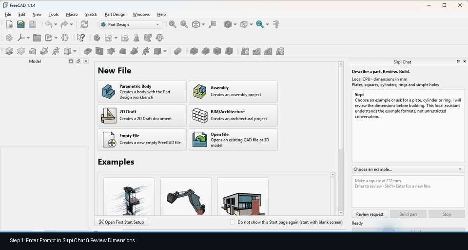
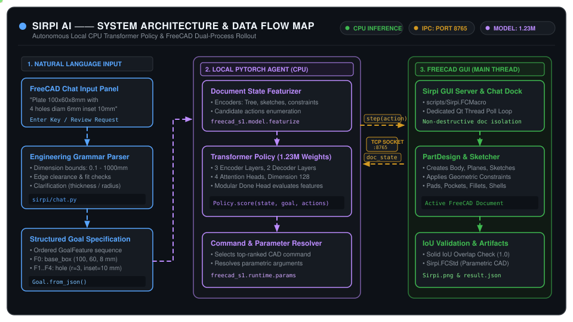
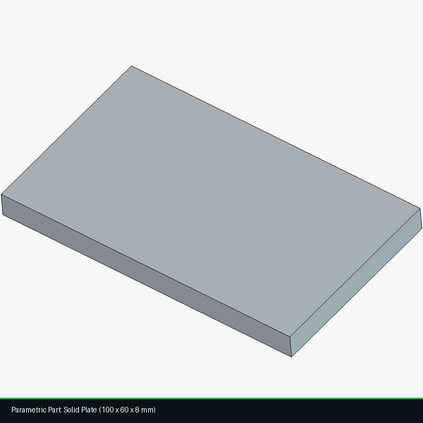

# Sirpi AI

<div align="center">

**Autonomous, Local CPU-Powered CAD Modeling Agent for FreeCAD**

[](https://www.python.org/downloads/)
[](https://www.freecad.org/)
[-orange.svg)](https://pytorch.org/)
[-informational.svg)]()
[]()
[]()
[](LICENSE)

<br/>



<p><em>Real FreeCAD interface driven autonomously by Sirpi AI — Natural language review, CPU inference, and parametric 3D solid construction.</em></p>

[Download ZIP](https://github.com/IndhirajithHari/sirpi-ai/archive/refs/heads/main.zip) • [Quick Setup](#step-by-step-installation-guide) • [Prompt Guide](#supported-prompts--geometry) • [Architecture Map](#system-architecture) • [Troubleshooting](#troubleshooting)

</div>

---

## 📌 Table of Contents

- [Overview](#overview)
- [Key Features](#key-features)
- [System Architecture](#system-architecture)
- [Prerequisites](#prerequisites)
- [Step-by-Step Installation Guide](#step-by-step-installation-guide)
  - [Step 1: Install Python and FreeCAD](#step-1--install-python-and-freecad)
  - [Step 2: Download and Unpack Sirpi](#step-2--download-and-unpack-sirpi)
  - [Step 3: Create Virtual Environment and Install Dependencies](#step-3--create-virtual-environment-and-install-dependencies)
  - [Step 4: Verify Installation (Pre-Flight Checks)](#step-4--verify-installation-pre-flight-checks)
  - [Step 5: Launch FreeCAD with Sirpi](#step-5--launch-freecad-with-sirpi)
  - [Step 6: Build Your First 3D Part](#step-6--build-your-first-3d-part)
- [Daily Usage (Next Time You Use Sirpi)](#daily-usage-next-time-you-use-sirpi)
- [Supported Prompts & Geometry](#supported-prompts--geometry)
  - [Part Syntax & Examples](#part-syntax--examples)
  - [Multi-Turn Conversations & Clarifications](#multi-turn-conversations--clarifications)
  - [Follow-up Modifications (Adding Holes)](#follow-up-modifications-adding-holes)
  - [Geometric Rules & Bounds](#geometric-rules--bounds)
- [Output Artifacts](#output-artifacts)
- [CLI Automation & Scripted Demos](#cli-automation--scripted-demos)
- [Project Structure](#project-structure)
- [Testing & Validation](#testing--validation)
- [Troubleshooting](#troubleshooting)
- [Lineage & Attribution](#lineage--attribution)

---

## 🌟 Overview <a id="overview"></a>

**Sirpi AI** is an intelligent, open-source CAD modeling agent that transforms natural language descriptions directly into fully editable, parametric 3D models inside **FreeCAD**.

Unlike conventional text-to-3D systems that output non-parametric triangulated meshes (`.stl`, `.obj`), Sirpi acts as an autonomous virtual CAD designer:
1. It parses your natural language input into validated engineering dimensions and structured geometric features.
2. It reasons sequentially using an embedded neural policy transformer (~1.23M parameters) executing on your local **CPU**.
3. It directly drives FreeCAD's native Python API—creating sketches, applying precise geometric constraints, padding, pocketing, and managing the active PartDesign feature tree in real time.
4. It mathematically validates the resulting solid model using Intersection-over-Union (IoU) solid geometry overlap checks before finalizing the `.FCStd` document.

> [!IMPORTANT]
> **100% Local & Free:** Sirpi runs entirely on your local CPU. No dedicated GPU, cloud subscriptions, API keys, or internet connection (beyond initial dependency setup) are required. Your design data remains strictly private on your computer.

---

## ✨ Key Features <a id="key-features"></a>

| Capability | Detail |
| :--- | :--- |
| **Local CPU Policy** | Runs lightweight transformer weights (`model.safetensors`, 1.23M parameters) on consumer CPUs with single-thread optimization. |
| **Native FreeCAD Tree** | Generates real parametric models (`PartDesign::Body`, `Sketcher`, `Pad`, `Pocket`, `Hole`) that you can inspect, modify, and export. |
| **Embedded Chat Panel** | Docked Qt GUI within FreeCAD featuring structured review, input validation, progress indicators, and instant file export links. |
| **Interactive Clarification** | Intelligently prompts for missing dimensions (e.g., thickness for a 2D outline, or diameter vs. radius) before modeling. |
| **Non-Destructive Workflows**| Preserves existing FreeCAD documents, manual user edits, and labels across builds. |
| **Automated Geometry Verification** | Verifies solid volume and bounding boxes against analytical ground truth (99%+ IoU required for success). |
| **Dual Interface** | Operate interactively via the **FreeCAD Chat Dock** or programmatically via the **`sirpi` CLI**. |

---

## 🏗 System Architecture <a id="system-architecture"></a>

Sirpi operates across a clean process boundary via a local JSON-over-socket bridge, isolating PyTorch inference from FreeCAD's Qt GUI loop:

<div align="center">
  
  <p><em>Animated Architecture &amp; Data Flow Map — Natural language parsing, CPU transformer policy, and FreeCAD main thread socket loop.</em></p>
</div>

<details>
<summary><b>Click to view ASCII Process Diagram</b></summary>

```text
┌─────────────────────────────────────────────────────────┐
│               Sirpi Python Subsystem (CPU)              │
│                                                         │
│   Natural Language Request  ──►  Template/Goal Parser   │
│                                           │             │
│                                     Structured Goal     │
│                                           ▼             │
│   Document State Snapshots  ──►  Neural Transformer     │
│   (Features, Constraints)         Policy (1.23M params) │
│                                           │             │
│                                     Ranked CAD Actions  │
└──────────────────────────┬──────────────────────────────┘
                           │  TCP Socket: 127.0.0.1:8765
                           │  Newline-delimited JSON (@@S1)
┌──────────────────────────┴──────────────────────────────┐
│             FreeCAD Main Process (Qt GUI Thread)        │
│                                                         │
│   Sirpi GUI Server (Timer)  ◄──  Action Dispatcher      │
│            │                                            │
│            ▼                                            │
│   FreeCAD PartDesign Engine (Sketches, Pads, Pockets)   │
│            │                                            │
│            ▼                                            │
│   Live Parametric 3D Model (.FCStd) + Render (.png)     │
└─────────────────────────────────────────────────────────┘
```

</details>

### The Rollout Execution Loop:
1. **Document State Snapshot:** FreeCAD captures the live document state (open features, constraints, active workbench, selection).
2. **Transformer Inference:** `freecad_s1.model` encodes the document state into typed tokens and evaluates candidate CAD commands against the active goal.
3. **Parameter Resolution:** `freecad_s1.runtime.params` assigns parametric values from the goal to the selected action (e.g., extrude depth, hole diameter).
4. **Command Execution:** FreeCAD executes the command on the active thread and renders the updated geometry.
5. **Convergence & Validation:** Once the policy outputs `Done`, the runtime constructs a reference target, calculates Intersection over Union (IoU), renders a 1600×1600 thumbnail preview, and saves the `.FCStd` project file.

---

## 📋 Prerequisites <a id="prerequisites"></a>

Before installing Sirpi, ensure your system meets the following specifications:

- **Operating System:** Windows 10 or Windows 11 (64-bit) *(Validated on Windows 11)*.
- **Python:** 64-bit **Python 3.11** or **Python 3.12** *(Python 3.12.14 recommended)*.
- **FreeCAD:** Official release of **FreeCAD 1.1.4** or **1.1.x** ([Official FreeCAD Releases](https://www.freecad.org/downloads.php)).
- **Hardware:**
  - Modern quad-core CPU (Intel Core i5/i7/i9 or AMD Ryzen 5/7/9).
  - 4 GB RAM minimum (8 GB recommended).
  - ~1.5 GB free disk space (includes virtual environment, PyTorch CPU, and weights).
  - **No dedicated GPU required**.

---

## 🚀 Step-by-Step Installation Guide <a id="step-by-step-installation-guide"></a>

Follow these sequential steps to set up Sirpi on your computer.

### Step 1 — Install Python and FreeCAD

1. **Install Python:**
   - Download the **Windows Installer (64-bit)** for Python 3.12 from [python.org](https://www.python.org/downloads/windows/).
   - Launch the installer.
   - > [!IMPORTANT]
     > Check the box labeled **"Add python.exe to PATH"** on the first screen before clicking *Install Now*.

2. **Install FreeCAD:**
   - Download the official stable installer from the [FreeCAD Download Page](https://www.freecad.org/downloads.php).
   - Complete standard installation (defaults to `C:\Program Files\FreeCAD 1.1\bin\freecad.exe`).

---

### Step 2 — Download and Unpack Sirpi

Choose **Option A** (ZIP Download) or **Option B** (Git Clone):

#### Option A: Direct Download (Recommended for most users)
1. Download the repository archive: [**Download Sirpi ZIP**](https://github.com/IndhirajithHari/sirpi-ai/archive/refs/heads/main.zip).
2. Right-click the downloaded `.zip` file, select **Extract All...**, and choose your desired folder (e.g., `C:\Projects\Sirpi` or `C:\Users\<YourUser>\Desktop\Sirpi`).
3. Ensure all files (`pyproject.toml`, `release/hf/model.safetensors`, `scripts`, `sirpi`, `freecad_s1`) reside inside the folder.

#### Option B: Git Clone
```powershell
git clone https://github.com/IndhirajithHari/sirpi-ai.git
cd .\sirpi-ai
```

---

### Step 3 — Create Virtual Environment and Install Dependencies

1. Open **PowerShell** in the Sirpi project directory:
   - Open File Explorer to your extracted Sirpi folder (where `pyproject.toml` is visible).
   - Click the address bar, type `powershell`, and press **Enter**.

2. Verify your Python version:
   ```powershell
   python --version
   ```
   *(Ensure this outputs `Python 3.11.x` or `Python 3.12.x`)*.

3. Create the isolated virtual environment:
   ```powershell
   python -m venv .venv
   ```

4. Upgrade `pip` and install CPU-optimized PyTorch:
   ```powershell
   .\.venv\Scripts\python.exe -m pip install --upgrade pip
   .\.venv\Scripts\python.exe -m pip install --timeout 120 torch --index-url https://download.pytorch.org/whl/cpu
   ```

5. Install Sirpi and its required packages:
   ```powershell
   .\.venv\Scripts\python.exe -m pip install --timeout 120 -e ".[dev]"
   ```

---

### Step 4 — Verify Installation (Pre-Flight Checks)

Before launching FreeCAD, run Sirpi's built-in diagnostic tools in PowerShell:

```powershell
.\.venv\Scripts\python.exe -m sirpi doctor
```

**Expected Output:**
```json
{
  "name": "Sirpi",
  "version": "0.1.0",
  "python": "3.12.x",
  "dependencies": {
    "torch": true,
    "numpy": true,
    "safetensors": true,
    "huggingface_hub": true
  },
  "freecad_gui": "C:\\Program Files\\FreeCAD 1.1\\bin\\freecad.exe",
  "model": "...\\release\\hf",
  "local_weights": true
}
```

> [!TIP]
> If `freecad_gui` is null, set your custom path:
> ```powershell
> $env:SIRPI_FREECAD = "C:\Program Files\FreeCAD 1.1\bin\freecad.exe"
> ```

Next, run a fast CPU smoke test to verify local transformer inference:
```powershell
.\.venv\Scripts\python.exe -m sirpi smoke
```
*(Confirms `parameters: 1228163` and returns normalized action probabilities on CPU without launching FreeCAD).*

---

### Step 5 — Launch FreeCAD with Sirpi

Start FreeCAD configured with the Sirpi IPC environment:

```powershell
.\scripts\start-sirpi.ps1
```

FreeCAD will open, execute `Sirpi.FCMacro`, and initialize the local GUI server listening on port **8765**. On the right side of FreeCAD, the **Sirpi Chat** dock panel will appear.

#### 🔧 Fallback: If PowerShell Script Execution is Restricted
If Windows reports that script execution is disabled on your system (`PSSecurityException`), launch FreeCAD directly using PowerShell environment variables:

```powershell
$env:SIRPI_REPO = (Get-Location).Path
$env:SIRPI_PORT = "8765"
& "C:\Program Files\FreeCAD 1.1\bin\freecad.exe" "$env:SIRPI_REPO\scripts\Sirpi.FCMacro"
```

#### 🔍 Showing the Chat Panel Manually
If FreeCAD opens but the chat panel is hidden:
1. In FreeCAD, navigate to: **View → Panels → Sirpi Chat**.
2. If not listed, go to **Macro → Macros...**, point *User macros location* to your `scripts/` folder, select **`Sirpi.FCMacro`**, and click **Execute**.

---

### Step 6 — Build Your First 3D Part

1. In the **Sirpi Chat** input box, enter:
   ```text
   Create a plate 100 x 60 x 8 mm with 4 holes diameter 6 mm inset 10 mm
   ```
2. Press **Enter** or click **Review request**.
3. Sirpi will summarize the parsed parameters:
   - Base solid: 100 × 60 × 8 mm
   - 4 through-holes: 6 mm diameter
   - Inset: 10 mm from outer borders
4. Click **Build part**.
5. Watch FreeCAD autonomously create the sketch, pad the base, project hole circles, and pocket the holes through the body.
6. Once complete, click **Open result folder** to view your exported files.

---

## 🔄 Daily Usage (Next Time You Use Sirpi) <a id="daily-usage-next-time-you-use-sirpi"></a>

You do **not** need to reinstall dependencies each time. To use Sirpi in the future:

1. Open PowerShell in the project directory.
2. Run:
   ```powershell
   .\scripts\start-sirpi.ps1
   ```
3. Type your prompt into the **Sirpi Chat** panel, click **Review request**, and click **Build part**!

---

## 💬 Supported Prompts & Geometry <a id="supported-prompts--geometry"></a>

Sirpi uses an engineering grammar parser designed for high-precision parametric primitives.

### Part Syntax & Examples <a id="part-syntax--examples"></a>

All dimensions are in millimeters (`mm`). You can write units explicitly or omit them.

| Part Type | Example Prompts | Extracted Parameters |
| :--- | :--- | :--- |
| **Solid Plate / Box** | `Create a plate 100 x 60 x 8 mm`<br>`Make a block measuring 50 by 30 by 5 mm` | Width: 100, Depth: 60, Height: 8 mm |
| **Square Solid** | `Make a square at 2*2*0.5mm`<br>`Build a square 20 x 20 x 2 mm` | Width: 2, Depth: 2, Thickness: 0.5 mm |
| **Rectangle Solid** | `Make a rectangle 40 by 20 by 3 mm` | Width: 40, Depth: 20, Thickness: 3 mm |
| **Cylinder** | `Create a cylinder diameter 40 mm height 20 mm` | Radius: 20 mm, Height: 20 mm |
| **Hollow Ring / Pipe** | `Create a ring outer diameter 60 mm inner diameter 30 mm height 10 mm` | Outer R: 30 mm, Inner R: 15 mm, H: 10 mm |
| **Cylinder with Hole** | `Create a cylinder diameter 40 mm height 20 mm with a center hole diameter 10 mm` | Radius: 20 mm, Height: 20 mm, Hole R: 5 mm |
| **Plate with 4 Inset Holes** | `Create a plate 100 x 60 x 8 mm with 4 holes diameter 6 mm inset 10 mm` | Plate: 100×60×8, 4 holes at (10,10), (90,10), (10,50), (90,50) |

---

### Multi-Turn Conversations & Clarifications <a id="multi-turn-conversations--clarifications"></a>

If you provide incomplete information, Sirpi will ask clarifying questions:

#### 1. Missing Solid Thickness:
```text
User:   make a square at 2*2mm
Sirpi:  I read a 2 × 2 mm outline. To make a solid part, what thickness should it have?
User:   0.5 mm
Sirpi:  [Reviews: Square solid 2 × 2 × 0.5 mm. Ready to build!]
```

#### 2. Missing Dimensions:
```text
User:   Create a cylinder
Sirpi:  What diameter and height in mm?
User:   diameter 40 mm height 20 mm
Sirpi:  [Reviews: Cylinder diameter 40 mm, height 20 mm. Ready to build!]
```

---

### Follow-up Modifications (Adding Holes) <a id="follow-up-modifications-adding-holes"></a>

After successfully building a part, you can add a center through-hole without re-specifying the base:

```text
User:   now add a hole in centre at 1mm
Sirpi:  Does 1 mm mean the hole diameter or radius?
User:   diameter
Sirpi:  [Reviews: Updated part with centered 1 mm diameter through-hole]
```

*(Sirpi duplicates the model into a fresh document, preserves earlier work, and generates the new feature).*

---

### Geometric Rules & Bounds <a id="geometric-rules--bounds"></a>

- **Range:** All linear dimensions must be between **0.1 mm** and **1000.0 mm**.
- **Clearance:** Holes must fit completely within the base solid boundary with positive clearance.
- **Ring Condition:** Inner diameter must be strictly smaller than outer diameter.
- **Hole Type:** All holes currently penetrate through the complete thickness of the body.

---

## ⚙️ Output Artifacts <a id="output-artifacts"></a>

Every build generates an isolated timestamped directory inside `runs/chat/`:

<div align="center">
  
  <p><em>Parametric 3D parts generated autonomously by Sirpi on CPU (100% target overlap, IoU = 1.0).</em></p>
</div>

| Artifact | Format | Description |
| :--- | :--- | :--- |
| **`Sirpi.FCStd`** | FreeCAD File | Full native parametric document with feature tree and sketches. Re-openable in any FreeCAD installation. |
| **`Sirpi.png`** | Image (PNG) | High-resolution 1600×1600 orthographic rendered preview of the finished part. |
| **`result.json`** | JSON Metadata | Quantitative evaluation: step count, success boolean, and analytical IoU overlap score (`iou: 1.0`). |
| **`goal.json`** | JSON Goals | Exact structured feature goals fed into the neural policy. |
| **`build.log`** | Plain Text | Complete sequence of model-chosen CAD actions and FreeCAD console feedback. |

---

## 🤖 CLI Automation & Scripted Demos <a id="cli-automation--scripted-demos"></a>

In addition to the interactive GUI chat, Sirpi includes command-line rollout tools for testing, benchmarking, and batch generation.

With FreeCAD open and listening on port 8765:

### 1. Parametric Procedural Demo:
Build synthetic benchmark goals across complexity levels 1 to 3:
```powershell
.\.venv\Scripts\python.exe -m sirpi demo --level 3 --seed 7 --out runs\demo-seed7
```

### 2. Custom Structured Goals:
Execute pre-configured multi-feature CAD parts (e.g., industrial flange):
```powershell
.\.venv\Scripts\python.exe -m sirpi demo --goals showcase\goals.json --name flange --out runs\flange
```

### 3. CLI Command Options:
Run `.\.venv\Scripts\python.exe -m sirpi demo --help` to inspect options:
- `--delay <sec>`: Pause between executed CAD steps (default: `0.4s` for visual inspection).
- `--wait <sec>`: Connection timeout waiting for FreeCAD server (default: `30s`).
- `--port <int>`: Custom socket port (default: `8765`).

---

## 📂 Project Structure <a id="project-structure"></a>

```text
Sirpi/
├── .venv/                   # Isolated Python virtual environment (ignored in git)
├── docs/                    # Technical engineering specifications
│   ├── ARCHITECTURE.md      # Transformer neural policy & IPC protocol walkthrough
│   ├── CHAT.md              # FreeCAD chat panel user manual & grammar guide
│   ├── SETUP.md             # In-depth setup manual with edge-case configurations
│   ├── VALIDATION.md        # Regression test reports & geometric accuracy metrics
│   └── UPSTREAM_README.md   # Lineage reference from Taiga-S1
├── freecad_s1/              # Upstream CAD agent core (Taiga-S1 neural architecture)
│   ├── model/               # PyTorch transformer encoder-decoder & featurizers
│   ├── runtime/             # FreeCAD socket server, parameter resolvers, evaluators
│   ├── actions.py           # FreeCAD CAD action enumeration
│   └── schema.py            # Geometric state, features, and token representation
├── recordings/              # Validation screen captures & video transcripts
├── release/
│   └── hf/                  # Offline model weights & configuration
│       ├── config.json      # Transformer model hyperparameters & head configuration
│       └── model.safetensors# PyTorch tensor weights (1.23M parameters)
├── runs/                    # Timestamped output directories (.FCStd, .png, result.json)
├── scripts/                 # Launcher scripts & FreeCAD macros
│   ├── start-sirpi.ps1      # Automated PowerShell FreeCAD launcher
│   ├── Sirpi.FCMacro        # Main FreeCAD macro initializing server and chat panel
│   └── test-chat.FCMacro    # Headless GUI automated validation macro
├── showcase/                # Sample CAD goals (e.g. flange, bracket)
├── sirpi/                   # Sirpi core integration package
│   ├── chat.py              # Natural language prompt parser & dialogue manager
│   ├── chat_panel.py        # FreeCAD Qt dock panel widget & process runner
│   ├── cli.py               # CLI entrypoint (doctor, smoke, version)
│   └── demo.py              # Socket rollout client for FreeCAD GUI
├── tests/                   # Pytest automated test suite
├── NOTICE.md                # Open-source attribution and provenance notice
├── pyproject.toml           # Project configuration & build dependencies
└── README.md                # Project documentation
```

---

## 🧪 Testing & Validation <a id="testing--validation"></a>

Sirpi includes an automated test suite verifying prompt parsing, token featurization, CAD parameter constraints, and IPC boundary integrity.

Run the test suite with a local temporary baseline:
```powershell
.\.venv\Scripts\python.exe -m pytest --basetemp=.tmp/pytest -q
```
**Status:** `93 passed, 9 skipped` *(platform-specific skips apply only to POSIX/macOS legacy watchdogs)*.

---

## 🛠 Troubleshooting <a id="troubleshooting"></a>

| Issue / Error | Probable Cause | Recommended Fix |
| :--- | :--- | :--- |
| **`python is not recognized`** | Python not added to system PATH. | Re-run Python installer, choose **Modify**, and check **"Add Python to PATH"**. Restart PowerShell. |
| **`Scripts are disabled on this system`** | Windows PowerShell ExecutionPolicy restriction. | Use the manual startup command from [Step 5 Fallback](#-fallback-if-powershell-script-execution-is-restricted) without modifying execution policies. |
| **`FreeCAD GUI was not found`** | FreeCAD is in a custom or non-default path. | Set environment variable: `$env:SIRPI_FREECAD = "C:\Path\To\FreeCAD.exe"`, then re-run `sirpi doctor`. |
| **`Cannot reach Sirpi on port 8765`** | FreeCAD has not finished loading `Sirpi.FCMacro`. | Ensure FreeCAD is fully launched and displays `Sirpi GUI server listening on 127.0.0.1:8765` in **Report View**. |
| **`Set SIRPI_REPO` in FreeCAD** | FreeCAD was launched directly instead of via Sirpi launcher. | Close FreeCAD. Launch it using `.\scripts\start-sirpi.ps1` so the repository environment is injected. |
| **Sirpi Chat panel is missing** | Panel was closed or docked behind other views. | In FreeCAD menu: **View → Panels → Sirpi Chat**. |
| **`Build part` button remains disabled** | Request requires review or missing dimensions. | Press **Enter** or click **Review request**. If Sirpi asks a question (e.g., thickness), reply and review again. |
| **`No module named sirpi`** | Virtual environment dependencies not installed in editable mode. | Run `.\.venv\Scripts\python.exe -m pip install -e ".[dev]"`. |
| **Pip connection timeout during download** | Slow network connection downloading PyTorch wheel. | Re-run the pip install command with extended timeout: `--timeout 120`. |

---

## 📜 Lineage & Attribution <a id="lineage--attribution"></a>

Sirpi is derived from the open-source **[Taiga-S1](https://github.com/shhivv/taiga-s1)** project created by **Shiv Shanmugam**, licensed under the **MIT License**.

### What Sirpi Adds:
- Interactive **Sirpi Chat** Qt dock inside FreeCAD for natural language CAD construction.
- Engineering dialogue manager supporting multi-turn clarifications and dimension inference.
- Non-destructive modeling pipeline that preserves prior documents, manual edits, and labels.
- Automated Windows launcher (`start-sirpi.ps1`) and macro environment management.
- Comprehensive diagnostic tools (`sirpi doctor`, `sirpi smoke`).
- Extensive boundary test suite and full setup documentation.

Original MIT copyright and attribution are preserved in [`LICENSE`](LICENSE) and [`NOTICE.md`](NOTICE.md).

For deep architectural details, visit:
- [Architecture Walkthrough](docs/ARCHITECTURE.md)
- [Chat System & Grammar](docs/CHAT.md)
- [Advanced Setup Guide](docs/SETUP.md)
- [Validation & Verification Log](docs/VALIDATION.md)

---

<div align="center">
Built with ❤️ for the open-source CAD and AI engineering community.
</div>
